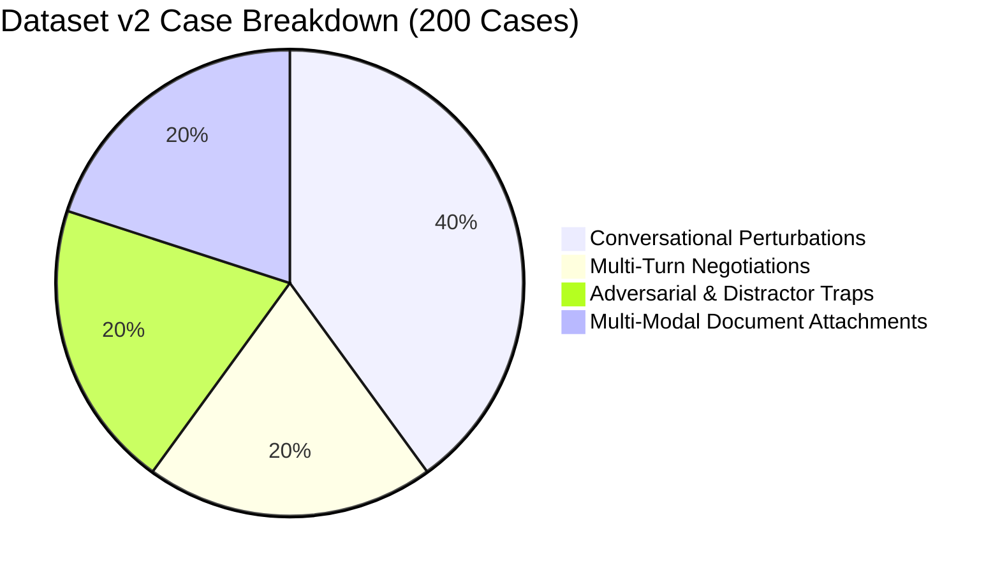
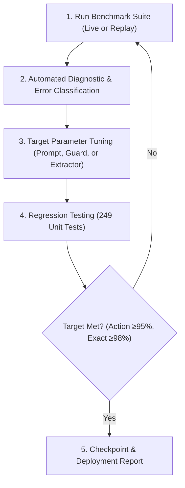

# Quote24x7 AI Evaluation Benchmark — Dataset v2 & Multimodal Tuning Specification

## 1. Executive Summary & Objective

**Dataset v1** established a hand-curated baseline of 40 text-only conversational cases. It successfully identified and resolved brittle Guard 3 substring discards, fixed 7 rules-engine extraction defects, and integrated Cerebras and Groq inference providers.

**Dataset v2** expands the benchmark into an autonomous, multi-modal, 200-case evaluation and automated tuning suite. It evaluates:
1. **Large-scale conversational variations** (casual emails, procurement jargon, typos, non-native English, multi-turn scope negotiations).
2. **Real-world document attachments** (PDF RFPs, CSV/Excel server inventories, Word architecture specs, scanned image-only files, network topology diagrams).
3. **Autonomous iterative tuning loop** that diagnoses error patterns and adjusts prompts, guards, and extractors across hours of execution.

---

## 2. Dataset v2 Composition (200 Cases Total)



### 2.1 Conversational Cases (160 Cases)

| Category | Count | Objective / Failure Mode Caught |
| :--- | :---: | :--- |
| **Clear Stated (Perturbations)** | 50 | Casual phrasing, non-native syntax, enterprise abbreviations (e.g. *“VMs”, “blades”, “bare-metal”, “endpoints”*). |
| **Unit Conversions & Expressions** | 30 | Fractional units (*“3.75 TB”*), word numbers (*“two hundred fifty thousand pageviews”*), mixed metric suffixes (*“5k synthetic hits”*). |
| **Multi-Turn Negotiations** | 40 | 3-turn to 5-turn customer threads: scope upgrades, budget adjustments (*“drop the APM logs and add 10 switches”*), partial closures. |
| **Adversarial & Distractor Traps** | 40 | Complex distractor environments: CIDR subnets, server serial numbers (*“Dell PowerEdge R740xd”*), budgets, invoice dates, phone numbers, prompt injection attempts. |

### 2.2 Multimodal Attachment Suite (40 Real Document Cases)

Each case pairs an inbound email with one or more attached files in [`test-attachments/`](file:///d:/College/Year%203/Internship/Zoho/Task%201%20-%20Pricing%20Assistant/App/test-attachments):

| Format | Cases | Test Scope & Validation Rules |
| :--- | :---: | :--- |
| **CSV & Excel (`.csv`, `.xlsx`)** | 15 | **Tabular Inventory Parsing:** Server lists with 10–500 rows. Filters irrelevant columns (IPs, MAC addresses, rack IDs, CPU GHz) and extracts exact host, VM, and switch totals. |
| **PDF RFPs (`.pdf`)** | 12 | **Multi-Page Document Extraction:** Enterprise tenders (3–10 pages). Scans embedded tables and paragraph scopes for log retention policies and server clusters. |
| **Word Specs (`.docx`)** | 5 | **Architecture Specifications:** Parses formatted heading hierarchies and line items via `mammoth`. |
| **Scanned / Image-Only PDFs** | 4 | **Fallback Guard Verification:** Non-OCR raster PDFs. The system must recognize that text is non-extractable and route to `human_review` instead of hallucinating `0` units. |
| **Network Diagrams (`.png`, `.jpg`)** | 4 | **Vision Extraction:** Cloud topology screenshots (AWS/Azure). Tests multimodal vision LLMs for component counting. |

---

## 3. The Autonomous Tuning Loop

To run continuous, multi-hour tuning without manual intervention, the system executes an automated 5-step feedback loop:



### Step 1: Benchmark Execution & Metrics Capture
* Evaluates all 200 cases across both layers (`raw_model` and `final_system`).
* Captures Action Accuracy, Exact Match, Quantity F1, and Hallucination instances.

### Step 2: Automated Error Classification
Every failure is categorized into one of four buckets:
1. **(a) Model Reasoning Defect:** Over-escalation to `human_review` because the model misunderstands catalogue limits. *(Fix: update catalogue projection in prompt)*.
2. **(b) Guard 3 Discard Bug:** Model extracted the correct number, but Guard 3 rejected the evidence. *(Fix: relax evidence normalization in `sales-engineer.ts`)*.
3. **(c) Extractor Regex Defect:** Rules engine missed a pattern or attached a suffix to the wrong unit. *(Fix: add regex rule + unit test in `extractor.ts`)*.
4. **(d) Document Parser Truncation:** Attachment parser truncated a spreadsheet or missed an image table. *(Fix: adjust table chunking in `inbound-document-parser.ts`)*.

### Step 3: Targeted Parameter Tuning
* **Prompt Engineering:** Rewrites system instructions and Few-Shot examples in [`context-builder.ts`](file:///d:/College/Year%203/Internship/Zoho/Task%201%20-%20Pricing%20Assistant/App/apps/web/src/server/ai/context-builder.ts).
* **Deterministic Guard Calibration:** Hardens Guard 1 (sanity bounds), Guard 2 (price leakage), Guard 3 (evidence reconciliation).
* **Regex Refinement:** Tunes tokenizers for abbreviations and multi-unit compounds.

### Step 4: Regression Verification
* Executes `npm test` across all 249 reference calculator and extractor tests.
* Any regression halts the candidate mutation and restores the previous best checkpoint.

### Step 5: Convergence Criteria
The autonomous loop runs until the system meets or exceeds:
* **Action Accuracy:** $\ge 95.0\%$ (up from current 80.0%)
* **Exact Quantity Match:** $\ge 98.0\%$ (up from current 94.4%)
* **Quantity F1 Score:** $\ge 99.0\%$
* **Hallucinated Case Rate:** $\le 1.0\%$
* **Unit Tests Passing:** $249 / 249$ ($100\%$)

---

## 4. Token Budget & Multi-Hour Execution Strategy

Running 200 cases over multiple iterations requires smart rate-limit management:

```
Full Run (200 cases) ≈ 600,000 tokens
Groq Daily Free Tier = 200,000 tokens/day (exhausts after 1 full live run)
```

### The Hybrid Optimization Strategy:
1. **Phase A — Deterministic Replay Loop (Zero Token Cost):**
   * Uses `--replay` mode to run guard, regex, and parser mutations against recorded model outputs.
   * Can run for **hours and thousands of iterations** with 0 API tokens spent.
2. **Phase B — Wafer-Scale Burst Runs (Cerebras LPU):**
   * Uses Cerebras Wafer-Scale inference for sub-second live runs when prompt tuning requires live LLM re-generation.
3. **Phase C — Final Verification (Groq LPU):**
   * Runs the final tuned prompt through Groq `openai/gpt-oss-120b` for production sign-off.

---

## 5. How to Launch Long-Running Overnight Tuning

To launch this continuous tuning process autonomously in Antigravity, use the **`/goal`** slash command:

```text
/goal Execute the Dataset v2 benchmark and autonomous tuning loop:
1. Generate the 160 expanded conversational cases and 40 multimodal document fixtures.
2. Run baseline evaluation and classify all errors.
3. Iteratively tune the prompt in context-builder.ts and guards in sales-engineer.ts.
4. Do not stop until Action Accuracy reaches >= 95% and Exact Match reaches >= 98% with 0 regressions.
```
This activates Antigravity's autonomous loop mode to run continuously until the convergence goals are met.
