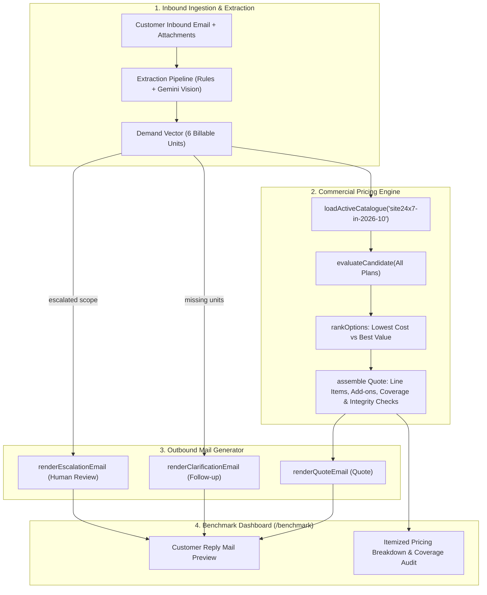

# Quote24x7 Benchmark — Outbound Reply Mail & Financial Pricing Specification

## 1. Executive Summary & Objective

In prior iterations, the `/benchmark` suite evaluated **input demand extraction**:
- Inbound customer email and attached enterprise documents
- Ground-truth expected demands vs. extracted units (`host_monitor`, `basic_monitor`, etc.)
- Action classification (`quote`, `ask_follow_up`, `human_review`)

While extraction accuracy reached **100.0% Exact Match (188/188 Stated)** on Dataset V2, evaluation remained incomplete for Team Leads (TLs) and procurement reviewers:
> **"The benchmark cases don't really have the output though, it just says accept quote. TL needs the reply mail there. They need the pricing details it gave, and have to see if that's correct or not."**

This specification defines the complete end-to-end integration of the **outbound email generation engine** and the **deterministic pricing engine** directly into the benchmark evaluation dashboard.

---

## 2. End-to-End Output Architecture

---

## 3. Data Model & API Specifications

Each test case item in `GET /api/v1/benchmark` is enriched with two primary audit structures:

### 3.1 `replyEmail`
The verbatim communication delivered to the customer inbox:
- **`subject`**: Normalized RFC email subject (e.g. `Re: Monitoring quote request`, `Quotation: Site24x7 Sizing - Ref Q-1042`).
- **`type`**: `"quote"` | `"clarification"` | `"review"`.
- **`body`**: Full plain text email body formatted according to Site24x7 sales guidelines:
  - Professional greeting with resolved recipient name.
  - Clear bulleted summary of understood requirements.
  - Sizing proposal table (Item | Qty | Coverage | Annual Cost in ₹ INR).
  - Alternative plan comparison note (e.g. Lite vs Professional).
  - Attached PDF estimate notification (`Site24x7-estimate-Q-xxxx.pdf`).
  - Standard compliance disclaimer and unique tracking reference.

### 3.2 `pricingDetails`
The complete commercial pricing audit:
- **`status`**: `"quoted"` | `"awaiting_clarification"` | `"enterprise_review"`
- **`recommendedPlan`**: e.g., `"Professional"` or `"Lite"`
- **`totalAmountFormatted`**: Grand total formatted in Indian Rupees (e.g., `₹99,180/yr` or `₹87,210/yr`)
- **`billingCadence`**: Annual (billed annually)
- **`currency`**: `INR` (`₹`)
- **`comparisonLine`**: Contextual comparison highlighting why the primary option was recommended over the alternative.
- **`lineItems`**:
  - `name`: Base plan subscription or specific Add-on pack (e.g. `10 Host Monitor Pack`).
  - `quantity`: Number of subscription licenses or packs.
  - `covers`: Explicit coverage mapping (e.g. `20 servers`, `10 websites`).
  - `unitPrice`: Cost per pack / month.
  - `lineTotal`: Total annual amount for that line item.
- **`coverage`**: Matrix comparing stated demand vs. plan-included capacity vs. add-on pack capacity.

---

## 4. UI / UX Design in `/benchmark`

Within each benchmark case card drop-down:
1. **Section 1 — Customer Inquiry (Input)**: Original email text and clickable attachment badges (PDF, Excel, Word, Diagram).
2. **Section 2 — Generated Reply Mail (Output)**:
   - Formatted email viewport with standard header (`Subject`, `From: quotes@site24x7.assist`, `To: buyer@company.com`).
   - Clean, monospace-rendered email content preserving table alignment.
   - One-click **"Copy Email"** button for quick pasting and validation.
3. **Section 3 — Financial Pricing Breakdown (Audit)**:
   - Summary cards displaying **Recommended Plan**, **Annual Total (INR)**, and **Billing Cadence**.
   - Itemized financial table:
     | Item | Quantity | What it covers | Unit Price | Annual Total |
     | :--- | :---: | :--- | :---: | :---: |
     | Professional base subscription | 1 | 5 servers, 10 websites, APM | ₹6,127.50 / mo | ₹73,530 |
     | 10 Host Monitor add-on pack | 2 | 20 servers | ₹12,825.00 / yr | ₹25,650 |
     | **Total Annual Cost** | | | | **₹99,180** |
   - **Coverage Verification Checklist**: Visual green checks verifying that all requested servers, website checks, logs, and network devices are satisfied.
   - **Alternative Comparison Line**: Outlines why another tier was rejected or ranked as secondary.

---

## 5. Verification & Review Criteria for Team Leads

| Check | Expected Behavior |
| :--- | :--- |
| **Exact Price Alignment** | The total displayed in the email matches the sum of line items in the pricing breakdown. |
| **Packs Calculation** | If a customer needs 25 servers and Professional includes 5, exactly 2 packs of 10 servers are added ($5 + 20 = 25$). |
| **Zero-Price Clarification** | Clarification emails for missing units contain **zero prices** or speculative estimates, adhering strictly to sales policy. |
| **Enterprise Escalation** | Custom tenders, RFPs exceeding automated thresholds, or multi-cloud migrations display proper human-review routing without automated quote commitments. |
